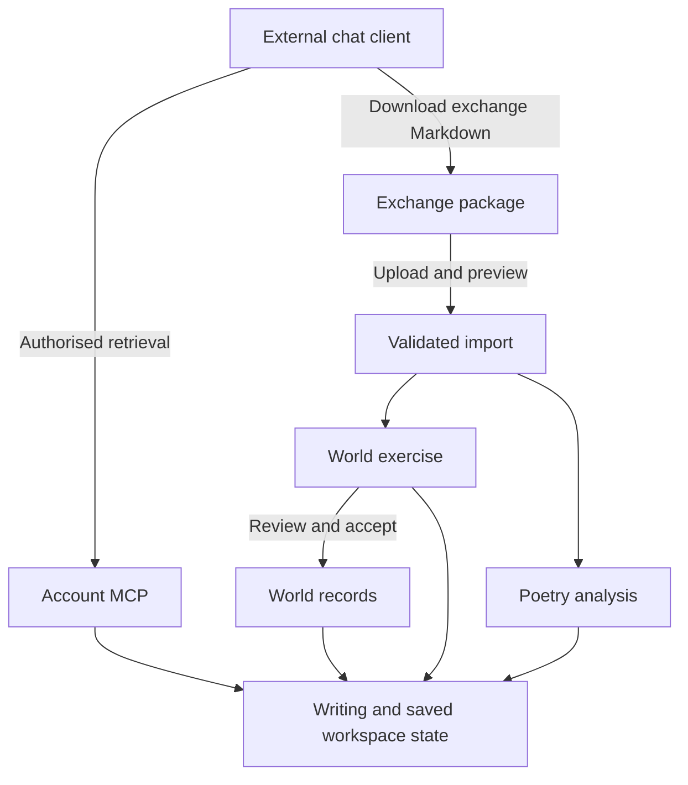

# Account MCP and external chat workflow

Date: 2026/11/08. Revised: 2026/11/10.

Status: revised plan, implemented locally on 2026/11/10 in the four slices of section 12; uncommitted and undeployed. This document does not authorise deployment or change production records. The account MCP endpoint stays off unless `ACCOUNT_MCP_ENABLED` is set.

Verified locally on 2026/11/10: packages previewed, saved, repeated and accepted through canon review inside rolled-back transactions; the internal assistant staging path compared side by side with the previous code; poetry import over real HTTP requests; the MCP endpoint with locally minted Passport tokens (default deny, grant boundaries, revocation, byte-exact poem text); `composer verify`.

Not verified: any real Claude, ChatGPT or Codex connection; the browser OAuth consent flow (sign in, authorise, code exchange, refresh); every new screen in a browser, including mobile layouts. The import screens were driven by script and compiled, not seen.

## 0. Revision of 2026/11/10: decisions resolved from the code

The first version left its hardest questions as "resolve during implementation". That is the same shape as the failure this plan exists to fix: a design that reads as complete while the path the author depends on is undecided. This revision settles each open item against the current code and installed packages, and removes work that the code shows is not needed.

| # | Original plan | Revised decision | Evidence |
|---|---|---|---|
| 1 | World payload "adapts" the typed proposal model | The world payload **is** the internal structured reply (schema 3): same idea shape, same per-kind rules, same validator. An import and an internal reply cannot drift because they are one definition | `SandboxProposals::decode()` already validates kind, fields, completeness, missing work, deliverable and links against `ProposalTypes` |
| 2 | Extract shared staging "where coupling requires it" | One seam, `ProposalSource`, with two origins (turn, import). It answers the seven things staging takes from a turn: expected revisions, citation rewriting, coverage, origin, source message, idempotency token and collected ids | `prepare()`/`collect()` read exactly those from `AssistantTurn` |
| 3 | Package-local stable references, to be designed | Already exist: link endpoints by idea index, `event_ref: "idea:N"`, `target_key` + revision for existing records, `proposal_id` + `proposal_revision` for refinements. The only addition is that a package must state `target_revision` itself, because there is no turn manifest to supply it | `SandboxProposals`, `ProposalTypes::validateScope()` |
| 4 | Access receipts table to support citation validation | Dropped. Revisions and fingerprints already prove which version a client worked from: records return `revision`, poems return a snapshot `fingerprint`, and **reading a poem retains its snapshot** so a later analysis can always attach to the exact text read. Package `sources` are shown as self-reported | `PoemAnalysisSnapshot::capture()` is idempotent on (poem, fingerprint) |
| 5 | Five persistence responsibilities | Two tables: `studio_exchange_imports` (package, hashes, body, payload, receipt with mapping and source manifest as JSON) and `account_external_grants`. Mapping and manifest are never queried on their own, so they do not earn tables | Section 10 |
| 6 | Grants per connection | Grants per **author**, shared by that author's clients; connect and revoke per **client** through OAuth tokens. One place to decide what is readable; default deny | One author, three own clients; per-client grant sets tripled the consent surface for no isolation gain |
| 7 | "A compact discoverable tool set" | Four tools: `list_material`, `search`, `fetch`, `exchange_spec`. `search`/`fetch` use the exact shapes ChatGPT connectors require, so one server serves all three clients | OpenAI MCP documentation, checked 2026/11/10 |
| 8 | Transport/protocol "to be chosen" | Streamable HTTP via `Mcp::web`; installed `laravel/mcp` v1.1.2 negotiates 2025-03-26, 2025-06-18 and 2025-11-25 on initialize. No upgrade required | `ProtocolVersion::initializeSupported()` |
| 9 | Passport "subject to compatibility review" | `laravel/passport` v13.11 resolves cleanly; a separate `api` guard is used only by the MCP route. Fortify, session-only Sanctum and the `web` guard are untouched | `composer require --dry-run`, `Registrar::oauthRoutes()` |
| 10 | Reject duplicate JSON object keys | Dropped. PHP's decoder cannot detect them and a custom parser is not justified for a file the author uploads to their own account | — |
| 11 | Upload a file | Upload **or paste**. Chat clients do not always offer a download, and never do comfortably on a phone | — |
| 12 | Internal limit of 20 ideas per reply applies | Imports allow 150 ideas and 300 links. The 20 limit existed for provider output tokens and pushed the earlier timeline into three prose parents | Failure report, section 9 item 6 |
| 13 | "Allow creation without a connection" listed as work | Already true for exercises and poem conversations; no change needed | `ExerciseForm`, `PoemAnalysisRequest` `create` rules |
| 14 | Rollback by "disabling the endpoint" | One environment flag, `ACCOUNT_MCP_ENABLED`, registers or removes the OAuth discovery routes and `/mcp/account` together | Section 13 |

Slices replace the workstream table as the delivery order (section 12). Each slice ends in something the author can do, not in a layer.

## 1. Goal and agreed direction

Move model conversation and generation into the author's chosen Codex, Claude, or ChatGPT environment. Keep DreamersPalette as the durable home of writing, worldbuilding, exercises, poetry analysis, visualisation, correction, and reviewed acceptance.

This is a change to the process and delivery boundaries of existing capabilities. It is not a rebuild of the sandbox or poetry analysis, and it does not require repeating completed creative exercises.

The complete delivery covers world work and poetry together. Implementation workstreams have dependencies, but a single timeline demonstration is not the product scope.

### Author workflow

1. Connect an external client to the author's DreamersPalette account.
2. Retrieve relevant writing, world records, exercises, analyses, and author notes.
3. Discuss and develop the work in that client.
4. Request a DreamersPalette exchange Markdown file.
5. Upload or paste it into a new or existing world exercise or poem analysis conversation.
6. Inspect and correct the saved work using existing tools.
7. Accept selected world proposals through existing canon review when ready.
8. Resume from any supported client by retrieving the corrected saved state.

The external conversation is transient unless explicitly imported. The saved exercise or analysis is the durable continuation point.

### Success criteria

- Reading and importing require no model API connection configured in DreamersPalette.
- Imported world work populates the same structures used by manual editors and visual tools.
- Imported poetry analysis remains tied to the exact poem version analysed.
- Author corrections are retrieved on subsequent requests and protected from stale imports.
- Duplicate packages do not create duplicate work.
- Sources, uncertainty, unsupported structures, and incomplete coverage remain visible.
- An authenticated client cannot access another author's private material.
- The real hosted connection and actual import actions are verified before claiming live readiness.

## 2. Current implementation and reuse

Repository inspection establishes these foundations. Historical reports describe earlier states and must not override current code.

| Area | Current foundation | Planned treatment |
|---|---|---|
| Framework | Laravel 13, Livewire 4, Flux Pro; React poetry/publishing | Preserve each surface's conventions |
| MCP | `laravel/mcp` locked at v1.1.2; `routes/ai.php` registers local `dreamers-review` | Add an authenticated remote account server; retain packet server |
| Fixed packet retrieval | `ReviewServer`, `ReadReviewPacket`, `ReviewPacketAccess` | Reuse relevant paging and access patterns; do not broaden packet grants |
| Context | `WorldContext`, `ContextRetrieval`, `SourceReading`, `ExerciseContext` | Separate reusable authorised reads from turn execution and model summarisation |
| Structured proposals | `ProposalTypes`, `SandboxProposals`, `ProposalChildren` | One domain contract for internal responses and external packages |
| World workspace | `WorldExercise`, `SandboxIdea`, `SandboxLink`, existing sandbox views | Reuse; add import and saved external work |
| Acceptance | `Canonisation`, revision guards, change history and reversal | Reuse; import never bypasses acceptance |
| Poetry | `PoemAnalysisConversation`, immutable `PoemAnalysisSnapshot`, `PoemAuthorNote` | Add external analysis ingestion and retrieval |
| Poetry delivery | `PoemAnalysisController`, React analysis workspace, `PoemAnalysis` | Decouple save/render from provider execution |
| Provider records | `AssistantTurn`, connections, workers, usage ledger | Preserve existing history and optional execution; do not fabricate turns for imports |

Current coupling requiring focused change:

- `SandboxProposals::prepare()` and `collect()` require an `AssistantTurn`, including its evidence, response, and captured revisions.
- `ContextRetrieval::retrieve()` requires a turn and update access to its exercise; read-only account retrieval must not inherit that assumption.
- `SourceReading` mixes snapshots/retrieval with model-assisted reading and citation conventions.
- Poetry responses and snapshot manifests currently arrive through an execution workflow.
- Sandbox provenance and activity views assume internal generation in several paths.

Not coupled, despite the first version of this plan: exercises and poem analysis conversations can already be created without a connection. Only sending a message requires one.

Do not estimate a completion percentage from code reuse. Account auth, import correctness, and actual client interoperability remain real implementation work.

## 3. Architecture and ownership

### Boundaries

- MCP tools own protocol delivery and invoke authorised application reads.
- Form Requests and Livewire Form Objects own routine input validation at their respective boundaries.
- Models own entity lifecycle, revisions, idempotency state, archival and snapshot behaviour.
- Cohesive services coordinate cross-model context reads, import validation, reference resolution, and proposal staging where needed.
- Existing `ProposalTypes` definitions remain the authoritative world field contract. Extend them only for actual supported domain structures.
- Provider orchestration calls the shared staging workflow; file imports call the same workflow without a provider turn.
- Canonisation remains a separate author action.

Avoid repositories, per-verb action classes, a parallel worldbuilding engine, or broad namespace moves. Extract meaningful responsibilities only where execution coupling requires it.

## 4. Clients, transport and authentication

### Intended client support

| Client | Planning basis | Evidence still required |
|---|---|---|
| Codex | Author confirms MCP support | Actual connection, auth and representative tool invocation |
| Claude | Author confirms MCP support; remote connectors documented | Actual connection, auth and representative tool invocation |
| ChatGPT Pro | Official documentation confirms custom MCP read/fetch access | Actual account connection and retrieval |

Read-only MCP plus file upload is the complete baseline. Direct remote write support is not required. ChatGPT account settings have not been inspected in this session. Client entitlement is not a reason to reduce the product scope.

### Transport

- Publish the account MCP endpoint at `/mcp/account` (streamable HTTP, `Mcp::web`), registered only when `ACCOUNT_MCP_ENABLED` is true. `oauth`, `mcp` and `.well-known` are reserved from the SPA catch-all route.
- The installed `laravel/mcp` v1.1.2 negotiates protocol 2025-03-26, 2025-06-18 and 2025-11-25. No package upgrade is required.
- Existing STDIO packet access remains restricted to its fixed packet. It does not become an unrestricted account server.
- Local tooling and hosted clients may use different connection configuration while sharing authorised domain reads.
- Do not claim that changing local Codex configuration configures ChatGPT Work or Claude web.

### Authentication and grants

- Use Passport (v13) as the OAuth server, on its own `api` guard applied only to `/mcp/account`. Dynamic client registration is throttled and limited to the redirect domains of the intended clients (claude.ai, claude.com, chatgpt.com, chat.openai.com, and localhost for CLI clients), not `*`. Access tokens last one day and refresh tokens sixty.
- Keep existing Fortify login, session-only Sanctum behaviour, shared-user identity, and publishing boundaries intact.
- Verify discovery metadata, client registration mechanism, redirect validation, PKCE, token audience, expiry, refresh, logout/revocation behaviour, and supported protocol versions against actual clients.
- OAuth establishes identity. Every tool call then checks, in order: verified email and the `account.external-access` permission, the resource policy, and the author's grant. A missing grant and a missing record look the same to the client.
- Grants belong to the author and are shared by that author's connected clients (`account_external_grants`: world, manuscript, collection or poem, each with an explicit "include workspace" flag for sandbox exercises or private analyses and notes). Connecting and revoking are per client. Nothing is readable until selected.
- A selected world must not implicitly expose every linked manuscript. A poem's public visibility does not expose its private analysis.
- Distinguish unpublished writing, current world state, finished snapshots, archived material, and discussion history in consent and reads.
- Revocation takes effect on the next request; downloaded data cannot be recalled.

Laravel's documented MCP OAuth integration defaults to `mcp:use`; granular project grants must be enforced in application code rather than assumed to exist as OAuth scopes.

Account → External access (`/account/connections`) shows the connection URL, the readable-material selection, and each connected client with its connected date, token expiry and Revoke. Credentials remain server/client private and are never returned as content.

## 5. MCP retrieval contract

Four read-only tools deliver every capability group below:

| Tool | Input | Purpose |
|---|---|---|
| `list_material` | none | What this author has made readable, as stable references |
| `search` | `query` | Grant-scoped search; returns `{results: [{id, title, url}]}`, the shape ChatGPT connectors require |
| `fetch` | `id`, optional `offset`, `limit` | Read one reference; returns `{id, title, text, url, metadata}` with `next_offset` paging |
| `exchange_spec` | `destination` | The exchange contract, generated from `ProposalTypes`, with limits and worked examples |

References are stable strings: `world:1`, `world:1/person:3`, `manuscript:2`, `chapter:55`, `exercise:13`, `exercise:13/messages`, `collection:3`, `poem:7`, `analysis:4`. `AccountAccess` owns the authorised reads; the tools only deliver them.

| Capability | Required content |
|---|---|
| Discover account material | Authorised worlds, manuscripts, collections and poems; stable references and summaries |
| Inspect world | People, events, encyclopedia, relationships, systems, arcs, calendars, alignments, comparisons, maps, investigations and knowledge |
| Read writing | Manuscript/chapter catalogue and selected prose ranges; distinguish working and finished drafts |
| Search | Scoped passages, record text, exercise content and analyses with resolvable matches |
| Read exercise | Brief, instructions, author summary, ideas, structured fields, links, scenarios, revisions, status and changes |
| Read poetry | Exact lineation, title, collection context, snapshot identity, comparisons and reusable author notes |
| Read analysis | Saved analyses, imported deliverables, version context and author corrections |
| Get exchange specification | Version, field schemas, supported structures, limits, reference semantics and complete examples |
| Get continuation context | Current state plus relevant unresolved work; distinguish author-approved summaries from generated claims |

### Response requirements

- Return a stable reference, resource type, revision or fingerprint, source version, current/archive state, authorised application link, and relevant ownership scope.
- Include pagination/chunk units, total where known, next cursor/offset, and explicit completeness/omission metadata.
- Return manuscript prose without model-generated summarisation. Existing summaries can be returned as labelled summaries, never substituted silently for the original.
- Preserve poem whitespace and line breaks exactly. Define line numbering and Unicode handling once.
- Provide raw structured children when requested: arc beats, system rules/cases, participants, comparison cells, and placements.
- Distinguish canon, pending, alternative, accepted, archived, and superseded work.
- Search respects grants and has deterministic bounds; search failure is not an empty result.
- No arbitrary database queries, paths, credentials, shell access or unrestricted URL fetching.

Snapshots and current records are different resources. Return what was requested and label the version explicitly. A finished draft's captured world must not be replaced with today's world.

### Retrieval provenance

No access-receipt table. Version identity does the work a receipt would:

- every world record is returned with its `revision`, and a package that updates it must state that revision, so a stale read is a visible conflict;
- reading a poem retains its `PoemAnalysisSnapshot` and returns the fingerprint, so an analysis imported later attaches to the exact text the client read, even after the poem is revised;
- snapshot retention is independent of token expiry or revocation.

External packages cannot certify their own reading coverage or author decisions. Package `sources` and `decisions` are stored and shown as self-reported, and imported ideas carry coverage `recorded: false, external: true`.

## 6. Exchange Markdown specification

### File design

Use Markdown, uploaded as a `.md` file or pasted, containing readable prose and exactly one fenced JSON block whose info string is `dreamerspalette-exchange`. `ExchangePackage` owns parsing and the published specification.

- The JSON is authoritative for structured import.
- Readable prose is retained as the explanation/analysis accompanying the imported work.
- Preview states which text and fields will save; editing narrative alone must not imply a change to structured fields.
- Reject missing/multiple payloads, malformed JSON, unsupported versions, unknown structural fields, and excessive nesting/size. Limits: 1 MiB file, 400,000 characters of prose, 150 ideas, 300 links, JSON depth 12.
- Parse deterministically. Do not call a model to repair or interpret the package.
- Render Markdown with existing safe rendering conventions; no executable HTML, remote includes or fetched attachments.

### Proposed envelope

| Field | Meaning |
|---|---|
| `format` | Fixed DreamersPalette exchange identifier |
| `version` | Exchange version, independent of MCP and current internal reply schema |
| `package_id` | Unique package identity for repeat-upload handling |
| `parent_package_id` | Optional previous imported package for continuation/refinement |
| `destination` | World exercise or poem analysis intent and stable reference |
| `title` / `brief_md` | Human-readable task and outcome context |
| `sources` | Resource references, versions, cited ranges and optional receipts |
| `decisions` | Explicitly attributed author decisions and model suggestions |
| `world` or `poetry` | Exactly one domain payload |
| `continuation` | Completed scope, missing scope, unresolved questions and next work |
| `external_origin` | Optional client/model label and conversation URL, marked self-reported |

The envelope contains no trusted author ID, permission, price, token usage, or server-issued completion claim. Destination selection and authenticated ownership are resolved by the application.

### Domain payloads

World payloads are the current typed proposal model, unchanged: `deliverable`, `ideas` (kind, title, fields, notes, basis, evidence, completeness, missing work, target reference/revision, proposal reference/revision, alternatives, lane, position) and `links`. They are validated by `SandboxProposals::validate()` and staged by `SandboxProposals::stage()`, the same code the internal assistant uses. `target_revision` is required with `target_key`.

Poetry payloads contain analysis Markdown, exact main-poem snapshot reference/fingerprint, selected comparison snapshots, included author-note revisions/fingerprints, optional suggested notes, and continuation context. A collection-wide analysis is not implied by access to collections; this release saves analyses in the existing per-poem workspace.

Do not require disclosure of hidden reasoning. Retain useful explanations, evidence, uncertainty and decisions.

### Field and reference rules

- Omitted fields preserve existing values. Explicit null/empty values clear only where the domain permits it and preview shows that consequence.
- Existing references include type, identifier and expected revision/fingerprint.
- New records use package-local stable references. Resolve them before staging children and links.
- Reject duplicate local references, unresolved references, wrong types, cross-world relationships, unsupported links, and invalid child references.
- Read-only source references may point to authorised comparison material outside the destination world; mutation targets and world links must satisfy destination scope.
- References must not rely on names alone or unstable array positions across packages.
- New-child references must resolve through to acceptance. If existing acceptance cannot handle a reference family, extend that mapping or report unsupported structure; never discard it.
- Preserve current merge/replace child semantics and show replacement consequences in preview.
- Unknown fields are errors, not content silently moved to Notes.
- Do not infer deletions from absent records. Archival remains an explicit existing application action.

### Contract coverage

| Family | Required meaningful output |
|---|---|
| Timeline | Event records, order, participants and supported calendar information; distinguish chronology, narrative order and layout |
| Character | Actual supported profile fields; separate relationship/event proposals when requested |
| Arc | Subject/context, measure and beats with valid event references |
| Encyclopedia | Entry type, name, aliases and content |
| Relationship | Explicit subjects, direction/mutuality, period and supported meaning |
| System | Supported rules and cases with valid child references |
| Knowledge | Truth, beliefs/knowers and supported reveal context |
| Investigation | Question, subjects, evidence, open questions and conclusion |
| Alignment | Axes and actual placements |
| Comparison | Criteria, subjects and cells |
| Calendar | Valid supported months/week/leap configuration |
| Map | Supported notes, dimensions, pins and journey; image generation/import is not implied |
| Naming/thought/question | Existing sandbox semantics; no accidental claim that these became canon records |
| Poetry | Analysis attached to exact sources, comparison context and attributed notes |

Publish known limitations per family. A label of complete is rejected when required supported structure is absent. A partial result retains missing work; unsupported work cannot be accepted as completed canon.

## 7. Import lifecycle and reconciliation

1. Upload through the destination workspace or choose a destination during import.
2. Preserve the original bytes privately with a server hash.
3. Validate envelope/version, bounds, author access, destination and source references.
4. Validate domain structures, dependencies, expected revisions and supported operations.
5. Present a preview: new records, refinements, source versions, unresolved references, missing work, changes and conflicts.
6. Confirm the normal Save import action. Revalidate under transaction/locks against current state.
7. Stage the connected world package atomically, or save the poetry analysis atomically.
8. Return a receipt with saved IDs, proposal mapping, warnings and application link.
9. Continue correction and world acceptance using existing tools.

Preview is not a reservation. A record can change before Save; the commit must reject stale assumptions.

### Repeat uploads and refinements

| Situation | Required handling |
|---|---|
| Same package ID and same canonical payload | Return existing receipt; do not modify corrected records |
| Same package ID and different canonical payload | Reject identity collision; require a new package ID |
| New package refines unchanged pending proposals | Show field diff and save a new revision |
| Pending proposal changed after retrieval | Conflict; preserve local corrections |
| Original target changed after retrieval | Flag conflict and block stale update/acceptance |
| Proposal was accepted | Retrieve current canon and create a fresh pending proposal; do not edit accepted history |
| Proposal archived | Do not resurrect it implicitly |
| New package repeats earlier records without explicit references | Warn about possible duplicates; never fuzzy-merge by name |
| Preview invalid | No partial staging; retain errors for correction |

Use database uniqueness and locking for idempotency, not only browser state. Hash the validated canonical payload for identity comparison and retain a separate raw-file hash. Explain both if narrative changes accompany an otherwise identical payload.

Allow a conflicted refinement to be saved as an explicit alternative when the author chooses. Do not automatically merge it or overwrite the baseline. A usable conflict UI can be a side-by-side diff with refresh or alternative actions; automatic three-way merging is not required.

Do not automatically undo imports by deleting their proposals after the author has edited or accepted them. Retain package history; archive eligible pending work through existing behaviour. Canon reversal remains separately guarded.

## 8. World exercise experience

- Add Import work to sandbox actions; new exercises can be created without selecting a model connection.
- Retain Discuss, Board, Timeline and List modes. Imported readable work appears in the exercise's saved discussion/document history with external-origin attribution.
- Do not expose provider Retry/Stop/model controls on imported items.
- Retain existing manual editing, alternatives, naming tools, connections, layout, undo and canon review.
- Show meaningful import/source status in the existing inspector rather than creating another dashboard of cards.
- Keep layout changes separate from semantic event order. Where current revision tracking combines them, define a conservative conflict policy initially and document it; do not silently ignore author arrangement changes.
- Subsequent MCP reads include current proposal fields and statuses, not merely the original uploaded file.
- Existing internal conversations and turns remain readable. Internal chat can remain optional; removal is a separate decision.

Saved continuation context includes brief, current structures, author corrections/notes, alternatives, unresolved work and acceptance state. A summary supplements these records; it never hides the actual current data.

## 9. Poetry analysis experience

- Add Import analysis to the existing React workspace; allow conversation creation without a connection.
- Reuse `PoemAnalysisSnapshot` for exact main/comparison source text and collection context.
- If current poem text differs, save against a verified retained snapshot and show newer-version status. If the claimed old source is unavailable, require exact source text that matches its fingerprint or explicit author resolution; never attach silently to current text.
- Preserve exact lineation and source inspection.
- Imported analyses render as saved external work without provider execution status or fabricated usage.
- Author notes remain reusable first-class records. Suggested author notes require explicit promotion; model interpretations do not become author intent automatically.
- No poem edits or publication occur on analysis import.
- Retrieval returns current author notes, selected previous analyses and their source versions, including the distinction between latest-version and previous-version discussion.
- Include sound and page guidance in the exchange instructions: cadence, repetition, rhyme, mouthfeel, sonic ambiguity, lineation and meaning.

## 10. Persistence and migration approach

Use additive forward migrations. Studio/publishing are deployed; do not rewrite history or reset the local database.

Proposed persistent responsibilities, with exact names/schema decided after database-guide review:

| Table | Holds |
|---|---|
| `studio_exchange_imports` | Author, destination (world/exercise or poem/conversation/snapshot), package and parent package ids, format version, status (`previewed`, `saved`), private raw file path and hash, canonical payload hash, readable body, validated payload (including the self-reported source manifest), receipt (preview summary, saved ids, package index → idea mapping, warnings) and self-reported external origin. Unique on (author, package id) |
| `account_external_grants` | Author, resource type and id, include-workspace flag. Unique on (author, type, id) |
| Passport's own tables | OAuth clients, authorisation codes, access and refresh tokens |

`studio_assistant_messages` gains a nullable `import_id`. Imported ideas use `origin = 'import'`, a `source_token` of `import:{id}:{index}` and provenance naming the import. No `AssistantTurn`, connection or usage row is created for an import.

Define snapshot retention deliberately: imported analyses/citations must remain intelligible after account disconnection. Connection tokens expire independently of retained creative history. Retain successful import originals with recoverable workspace history; prune failed/uncommitted upload bytes after a documented short window. Permission changes still govern future access.

Use deliberate indexes for author/destination lookup, package uniqueness, source lookup, archival and recent activity. Do not add cascade deletes by default. Do not copy local data to Anubis.

## 11. Security, cost and failure behaviour

- Treat writing and imported text as authored data, never instructions to execute tools or fetch arbitrary links.
- Enforce file size, record count, text length, recursion, search, paging and request-rate limits; publish actual supported limits in the exchange specification.
- First release uses text packages; remote URLs are attribution only and are not fetched automatically.
- Keep MCP reads and imports independent of model generation, paid provider allowance and detached generation workers.
- Imported items show external origin and unknown external token/cost usage. Do not fabricate a zero-cost provider request.
- Record application operations separately from inference accounting; ordinary server/storage costs remain.
- Return actionable errors identifying structural paths and stale references. Normal invalid packages are validation outcomes, not system incidents.
- Report unexpected failures through existing incident handling with identifiers, not manuscript text or credentials.
- Keep OAuth discovery/registration/token abuse bounded. Verify consent, credentials and grants in the actual deployed environment.
- A disconnected or unavailable client does not prevent manual editing or uploading a previously prepared file.

## 12. Implementation workstreams

### Delivery slices (2026/11/10)

Delivery order is four slices. Each ends in an author action that can be exercised for real, which is the check the earlier build lacked.

| Slice | Delivers | Author can then | Depends on |
|---|---|---|---|
| 1. Exchange core | `ExchangePackage`, `ExchangeImports`, `ExchangeImport`, `ProposalSource`, provider-independent `SandboxProposals::stage()`, migration | Nothing visible yet; proven by running real packages through preview, save and canon acceptance | — |
| 2. World import | Import work in the sandbox: upload or paste, preview with conflicts and possible duplicates, save, imported document in Discuss | Bring a timeline or character work in from any chat and review it with existing tools | 1 |
| 3. Poetry import | Import analysis in the React workspace, snapshot-aware save, imported rendering | Save an external analysis against the exact poem version | 1 |
| 4. Account MCP | Passport, `/mcp/account`, four tools, grants, Account → External access | Connect a client and read selected material | Independent of 2 and 3 |

Slices 1 and 4 touch disjoint files and were built in parallel; 2 and 3 followed 1 in parallel. The workstream table below remains the scope checklist.

### Workstreams

These workstreams deliver the entire agreed flow. Their ordering reflects dependencies, not a proposal to rebuild a small creative exercise first.

| Workstream | Work | Exit evidence |
|---|---|---|
| A. Contract and persistence design | Map every proposal family through decode, staging, review and acceptance; define exchange envelope, sources, revisions, references, limits and origin | Capability matrix against current code; documented schemas/examples; explicit unsupported cases |
| B. Provider-independent save path | Extract shared authorised reads/staging from turn orchestration; add import provenance and persistence | Internal paths remain usable; external save requires no provider connection or fabricated turn |
| C. Account MCP | OAuth/grants, endpoint, discovery, search/read/exercise/analysis/specification tools and connection management | Actual client discovery/auth/read; account and resource isolation verified |
| D. World imports | Upload, validation, preview, atomic staging, duplicate handling, refinements and conflict UI | Structures render/edit in all applicable existing tools and accept through current review |
| E. Poetry imports | Snapshot-aware save, source/notes attribution, imported analysis rendering and retrieval | Correct analysed version and comparison context survive import and subsequent retrieval |
| F. Continuity and client guidance | Current-state export, continuation context, examples and connection instructions for each client | Corrections made in the app are returned to the next external conversation |
| G. Full verification and release preparation | Static gate, actual actions, fresh logs, deployed auth/config preparation and rollback | Evidence report separates local, hosted, client and unverified results |

Dependencies: A precedes shared contract implementation; B supports C/D/E; D and E use the same envelope but preserve domain behaviour; F joins both; G covers the complete delivery. No parallel agents are implied by these workstreams.

### Expected code touchpoints

- `routes/ai.php`, account connection routes, MCP server/tools and authentication configuration.
- `app/Models/WorldExercise.php`, `SandboxIdea.php`, `AssistantMessage.php` and poetry models where origin/lifecycle requires it.
- `app/Services/Worldbuilding/ProposalTypes.php`, `SandboxProposals.php`, `ProposalChildren.php`, `Canonisation.php`, `WorldContext.php`, `ContextRetrieval.php` and source reading where coupling requires it.
- `app/Services/Poetry/PoemAnalysis.php`, `app/Http/Controllers/Content/PoemAnalysisController.php` and poetry Form Requests.
- Sandbox Livewire class/Form Objects/Blade; React poetry services/workspace; account connection UI.
- New forward migrations, permission definitions, configuration and focused operational documentation.

Preserve unrelated uncommitted work. Do not change generated production assets in git.

## 13. Verification and release acceptance

No automated tests or separate manual testing charter are authorised by this plan. During implementation, verify directly using real request paths, disposable transactional records and scratch scripts outside the repository. Do not reset writing data.

Run `composer verify` before code handoff. It is a static/build gate, not proof of runtime behaviour. Exercise changed Livewire/API actions and inspect only fresh logs. Browser-only checks must be reported as such.

### Required evidence across the full scope

| Area | Required direct checks |
|---|---|
| Identity/access | Signed-out/expired/revoked tokens; another author; world-only grant versus manuscript prose; private analysis versus public poem |
| Client interoperability | Connect actual Codex, Claude and ChatGPT Pro clients; discover tools; retrieve authorised content; refresh/revoke behaviour |
| Retrieval | Pagination, source chunking, exact poem text, search, source versions, archive handling, current versus finished world |
| Contract families | Run representative valid payloads through actual import and persistence for every supported family, including child records and links |
| Invalid output | Malformed/multiple payloads, unknown fields/version, notes-only substitutes, unsupported structures and invalid references |
| Repeated work | Duplicate upload, concurrent duplicate save, changed content under same ID, refinement after author edit and acceptance |
| World outcome | Imported events/participants/order, beats, relationships and other structures appear correctly in existing tools; review and reversal remain guarded |
| Poetry outcome | Exact analysed snapshot, comparison sources, author-note changes, revised poem, external-origin rendering and subsequent retrieval |
| Recovery | Stale preview, interrupted save/retry, partial failure rollback and archived destination |
| Existing behaviour | Existing internal messages/turns, provider paths, manual editing and fixed packet MCP remain intact |

Ownership, idempotency, concurrency and immutable snapshots would normally warrant automated regression coverage. Under project instructions they are verified directly and remain an explicit attention item in the work report, with the paths actually exercised.

### Hosted release

1. Prepare a focused diff, schema changes, local evidence report and deployment instructions.
2. Obtain deployment authorisation when implementation is ready; this planning request does not deploy.
3. Back up according to existing deployment practice; apply additive migrations and OAuth configuration with correct public origins/callbacks.
4. Deploy the endpoint and import UI together where compatibility requires it; preserve current login and public readers.
5. Verify hosted discovery/authentication, selected actual reads, import-save-reload and subsequent retrieval using approved records.
6. Record client/version evidence and unresolved limitations. Do not call locally successful transport a live account connection.

Rollback: set `ACCOUNT_MCP_ENABLED=false` (removes the OAuth discovery routes and `/mcp/account` together), revoke affected client tokens if necessary, and roll back application code with additive-data compatibility preserved. Do not drop import/source history or reverse schema blindly. Existing manual tools and saved writing remain accessible.

## 14. Defaults, unresolved details and excluded scope

### Defaults established by this plan

- Full world and poetry workflow, with external conversation and existing in-app correction.
- Read-only remote MCP and deliberate Markdown upload.
- Private author-selected access; new resources require selection or a clearly chosen grant policy.
- One versioned exchange envelope; existing domain definitions reused.
- Saved external work is independently valid without provider credentials or turns.
- Imported world records remain pending until existing canon acceptance.
- Exact source versions, explicit uncertainty, idempotency and revision conflicts.
- Existing internal chat/history retained; provider execution becomes optional for this flow.

### Resolve during implementation from code and client evidence

Resolved on 2026/11/10 (section 0): transport and protocol versions, Passport integration, package marker and limits, grant model, receipts (dropped) and preview-file retention (24 hours).

Still open, each needing evidence this repository cannot produce:

- Real client connections. Claude, ChatGPT and Codex must each be connected to the hosted HTTPS site and exercised; local verification uses a locally minted token and cannot stand in for a client's OAuth flow.
- Whether an author may grant future resources (for example "every new poem in this collection"). Today a collection grant covers the poems in it; a new world or manuscript needs selecting.
- Layout and semantic revisions share one idea revision. A refinement of a proposal the author has only moved on the board is therefore reported as a conflict. This is conservative and visible; separating the two counters is a later decision.
- Per-client grant sets, if a less trusted client is ever connected.

Surface a decision to Tapuwa only when it creates a material product, data, access or operational consequence.

### Outside this delivery

- Automatic ingestion of entire external chat histories.
- Automatic publishing or direct canon mutation from a client.
- Remote write tools as a required capability.
- Replacing existing boards, timelines, editors or poetry analysis with new tools.
- Guaranteed whole-account model memory or proof of model comprehension.
- New media-generation pipelines, collection-wide analysis workspaces, unrelated tool expansions, or removal of historical provider features.

## 15. References and evidence status

Official documentation checked for planning on 2026/11/08:

- [Laravel MCP](https://laravel.com/docs/13.x/mcp): remote servers, authentication, tools and OAuth integration. Compare with installed v1.1.2 before using newer APIs.
- [Laravel Passport](https://laravel.com/docs/13.x/passport): OAuth server integration.
- [Connecting custom MCP servers in ChatGPT](https://help.openai.com/en/articles/12584461-connecting-custom-mcp-servers-in-chatgpt): Pro read/fetch support and custom connection flow.
- [Claude remote connectors](https://support.claude.com/en/articles/11175166-get-started-with-custom-connectors-using-remote-mcp): remote client connection requirements.
- [MCP authorization](https://modelcontextprotocol.io/specification/latest/basic/authorization): protocol authorisation requirements; select a mutually supported protocol revision during implementation.

Repository context inspected: project/architecture/Laravel/testing guides, existing packet MCP, current proposal definitions and staging/acceptance paths, world exercise models, poetry implementation and snapshot/conversation models. The earlier structured-output failure report supplies failure history; it is not a current capability inventory.

This document is a plan. No new endpoint, OAuth client, migration, package upload workflow, provider request, or live connection was created to prepare it.
